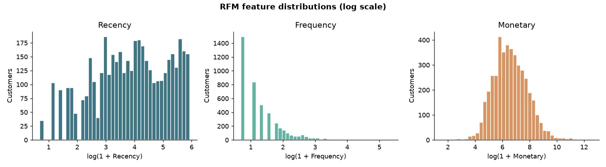
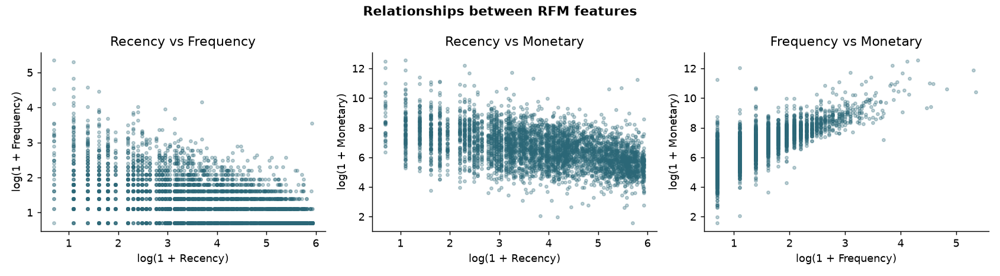
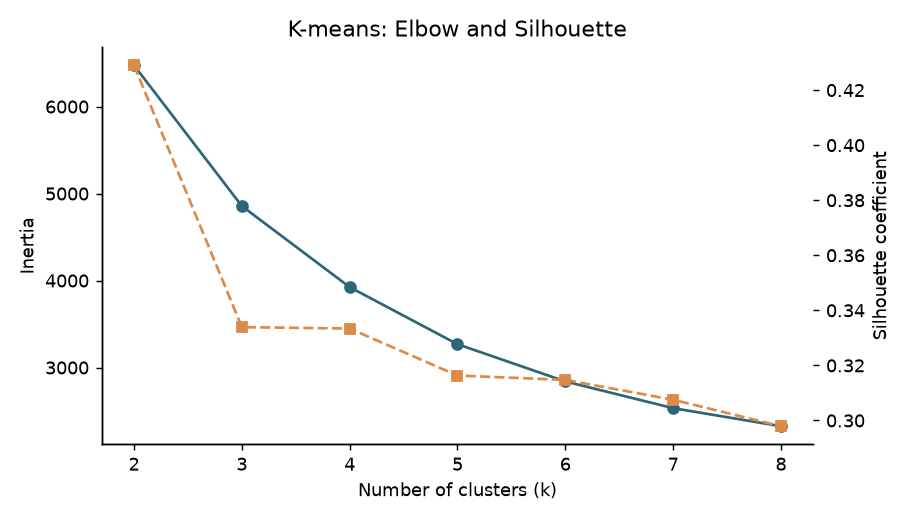
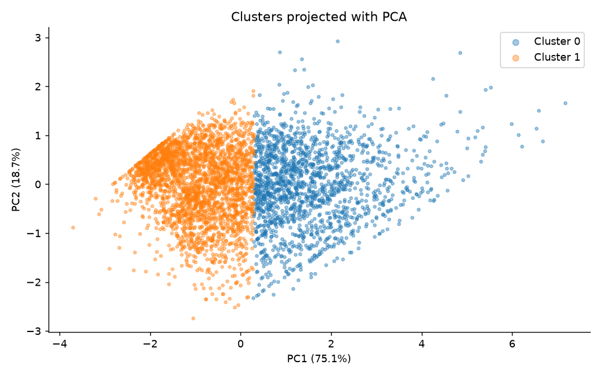
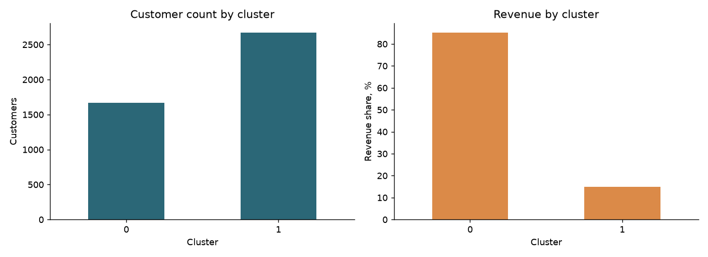
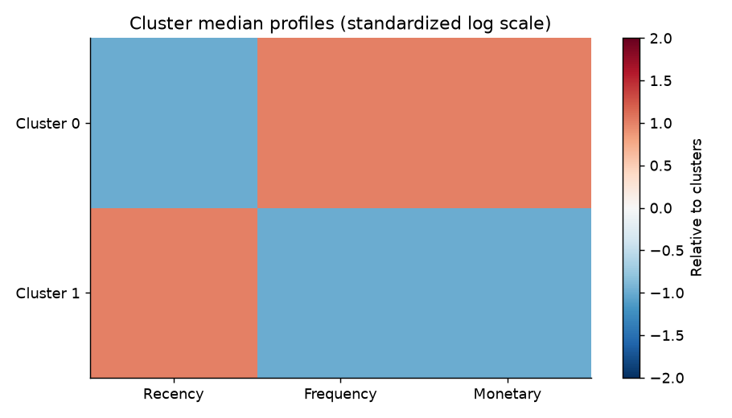

# Звіт з сегментації клієнтів методом K-means

**Виконала:** Черниченко Надія, група ТТП-42  
**Тема:** Customer Segmentation на основі RFM-показників  
**Мова реалізації:** Python; основні бібліотеки — pandas і scikit-learn

## Мета роботи

Мета — виділити групи клієнтів зі схожою купівельною поведінкою та пояснити відмінності між ними. Для цього історію транзакцій перетворено на RFM-показники та застосовано кластеризацію K-means. Готових класів клієнтів у даних немає, тому задача належить до навчання без учителя.

У результаті аналізу 4,338 клієнтів обрано **2 кластери** із Silhouette Score **0.4290**. Група з вищою медіаною витрат становить 38.47% клієнтів і забезпечує 85.11% врахованої виручки.

## 1 Попередня обробка даних

### Завантаження та структура

Використано [Online Retail з UCI Machine Learning Repository](https://archive.ics.uci.edu/dataset/352/online+retail), автор Daqing Chen, 2015, DOI [10.24432/C5BW33](https://doi.org/10.24432/C5BW33). Це історія операцій британського інтернет-магазину. Вхідний файл `data/Online Retail.xlsx` зчитано функцією `pandas.read_excel`.

Період очищених даних — **01.12.2010–09.12.2011**. Один запис відповідає товарній позиції замовлення; один рахунок може містити декілька записів.

Для розрахунків використано `CustomerID` — клієнт, `InvoiceNo` — номер замовлення, `InvoiceDate` — дата, `Quantity` — кількість товару та `UnitPrice` — ціна у GBP. Ідентифікатор клієнта застосовується для групування записів і не входить до ознак K-means.

### Очищення

Дати й числові значення приведено до відповідних типів. Рядки з пропусками в обов’язкових полях вилучено: без ідентифікатора неможливо визначити клієнта, а без дати чи суми — коректно обчислити RFM. Скасування, позначені літерою `C` на початку номера рахунку, і операції з непозитивною кількістю або ціною виключено. Вартість товарної позиції розраховано як `TotalPrice = Quantity × UnitPrice`.

| Показник | Значення |
|---|---:|
| Початкова кількість рядків | 541,909 |
| Рядки без CustomerID | 135,080 |
| Скасування після видалення пропусків | 8,905 |
| Непозитивні кількості або ціни після попередніх фільтрів | 40 |
| Рядки після очищення | 397,884 |
| Унікальні клієнти | 4,338 |
| Унікальні замовлення | 18,532 |

### Вибір ознак та обробка екстремальних значень

Для кожного клієнта сформовано три числові ознаки:

| Ознака | Зміст і розрахунок |
|---|---|
| Recency | Кількість днів між датою відліку та останньою покупкою |
| Frequency | Кількість унікальних InvoiceNo клієнта |
| Monetary | Сума TotalPrice за всіма врахованими покупками клієнта |

Датою відліку обрано **10.12.2011**, наступний день після останньої покупки. Менший Recency означає недавню активність, більші Frequency і Monetary — частіші покупки та вищі витрати. Frequency рахує замовлення, а не товарні рядки.

Коректні великі покупки не видалялися автоматично: вони можуть належати оптовим клієнтам. Для послаблення впливу екстремальних значень до кожної RFM-ознаки застосовано `log1p(x)`, тобто натуральний логарифм `1 + x`. Це зменшує асиметрію, але не усуває повністю чутливість K-means до викидів.

### Нормалізація

Після логарифмування застосовано `StandardScaler`: від кожного значення віднято середнє відповідного стовпця й поділено на його стандартне відхилення. Ознаки отримали порівнянний масштаб, тому сума покупок у фунтах не домінує в евклідових відстанях лише через великі числові значення.

## 2 Розвідувальний аналіз даних

Після агрегації отримано таблицю з 4,338 клієнтів і трьох ознак. Описова статистика наведена в початкових одиницях виміру.

| Ознака    |   Мінімум |   Медіана |   Середнє |   Максимум |
|:----------|----------:|----------:|----------:|-----------:|
| Recency   |      1.00 |     51.00 |     93.06 |     374.00 |
| Frequency |      1.00 |      2.00 |      4.27 |     209.00 |
| Monetary  |      3.75 |    674.48 |   2054.27 |  280206.02 |

Середні Frequency і Monetary перевищують відповідні медіани: розподіли зміщені в бік великих значень. Це підтверджує доцільність логарифмування перед кластеризацією.

*Рисунок 1 — Розподіли RFM-ознак у логарифмічному масштабі.*

Для дослідження зв’язків побудовано діаграми розсіювання для всіх трьох пар RFM-ознак. Кожна точка відповідає клієнту; на осях відкладено логарифмовані значення.

*Рисунок 2 — Попарні зв’язки між Recency, Frequency та Monetary.*

Кореляція Пірсона між логарифмованими Frequency і Monetary становить **0.808**: частіші покупки пов’язані з більшою загальною сумою витрат. Кореляції Recency із Frequency та Monetary становлять **-0.571** і **-0.487**. У цій вибірці клієнти з недавньою покупкою загалом мають більше замовлень і вищі витрати. Ці залежності описують дані та не доводять причинного зв’язку.

## 3 Реалізація K-means та вибір кількості кластерів

[K-means](https://scikit-learn.org/stable/modules/clustering.html) об’єднує клієнтів за близькістю їхніх стандартизованих RFM-векторів. Алгоритм почергово призначає точки найближчим центрам і перераховує центри груп, зменшуючи суму квадратів відстаней усередині кластерів.

Порівняно `k` від 2 до 8. Для кожного варіанта використано `random_state=42` та `n_init=10`. Фіксація випадковості забезпечує відтворюваність у тому самому середовищі; десять ініціалізацій зменшують залежність від початкових центрів.

Метод Elbow аналізує inertia — суму квадратів відстаней до центрів кластерів. Вона знижується зі збільшенням `k`, тому для автоматичного вибору використано найбільший Silhouette Score. Inertia наведено як додаткову характеристику.

|   k |   inertia |   silhouette |
|----:|----------:|-------------:|
|   2 | 6474.1464 |       0.4290 |
|   3 | 4856.5855 |       0.3339 |
|   4 | 3924.4597 |       0.3334 |
|   5 | 3268.2119 |       0.3163 |
|   6 | 2840.1514 |       0.3147 |
|   7 | 2533.0244 |       0.3075 |
|   8 | 2325.5230 |       0.2979 |

*Рисунок 3 — Inertia та Silhouette Score для k від 2 до 8.*

Найбільше значення Silhouette отримано для **k = 2**. Остаточну модель навчено на всіх 4,338 клієнтах. Номери кластерів є технічними мітками; назви сегментів призначено після аналізу медіан RFM.

## 4 Оцінювання та інтерпретація кластерів

[Silhouette Score](https://scikit-learn.org/stable/modules/generated/sklearn.metrics.silhouette_score.html) порівнює середню відстань клієнта до своєї групи із середньою відстанню до найближчої іншої групи. Значення лежить від −1 до 1; вищі значення означають краще відокремлення, а близькі до нуля — перекриття груп. Для швидкодії оцінку розраховано на фіксованій випадковій підвибірці з 2,500 клієнтів.

Підсумковий Silhouette Score — **0.4290**. Це найкращий результат серед перевірених варіантів, але він не означає повного відокремлення груп або відсотка точності класифікації. Для інтерпретації використано початкові, а не стандартизовані значення RFM. Медіани зменшують вплив окремих великих покупців на опис типового клієнта.

| Показник                      |   Кластер 0 |   Кластер 1 |
|:------------------------------|------------:|------------:|
| Кількість клієнтів            |     1669.00 |     2669.00 |
| Частка клієнтів, %            |       38.47 |       61.53 |
| Медіана Recency, дні          |       17.00 |       96.00 |
| Медіана Frequency, замовлення |        6.00 |        1.00 |
| Медіана Monetary, GBP         |     2062.70 |      363.70 |
| Сума покупок, GBP             |  7584592.77 |  1326815.13 |
| Частка виручки, %             |       85.11 |       14.89 |

**Кластер 0 — High-value loyal.** Містить 1,669 клієнтів (38.47% бази). Медіанна давність покупки — 17 днів, кількість замовлень — 6, сума витрат — £2,062.70. Частка врахованої виручки — 85.11%.

**Кластер 1 — At risk / low engagement.** Містить 2,669 клієнтів (61.53% бази). Медіанна давність покупки — 96 днів, кількість замовлень — 1, сума витрат — £363.70. Частка врахованої виручки — 14.89%.

Кластер 0 описує загалом активніших і цінніших покупців, а кластер 1 — покупців із нижчою залученістю. Назва «ризик втрати» є інтерпретацією профілю, а не результатом окремої моделі прогнозування відтоку. Характеристики групи не є жорсткими правилами для кожного її учасника.

## 5 Візуалізація кластерів

Для відображення трьох ознак на площині застосовано PCA. Перша компонента пояснює **75.14%**, друга — **18.71%** дисперсії перетворених даних; разом — **93.86%**. PCA використовується тільки для графіка: K-means працює з трьома підготовленими RFM-ознаками.

*Рисунок 4 — Проєкція клієнтів на дві головні компоненти з кольорами кластерів.*

На діаграмі показано взаємне розташування груп і клієнтів біля їхньої межі. Координати PCA є комбінаціями ознак, тому не вимірюються безпосередньо у днях або фунтах.

*Рисунок 5 — Кількість клієнтів і частка врахованої виручки за кластерами.*

Порівняння розміру груп із часткою виручки показує концентрацію покупок: кластер 0 містить 38.47% клієнтів і забезпечує 85.11% врахованої суми продажів.

*Рисунок 6 — Медіанні профілі кластерів після логарифмування та стандартизації між групами.*

Теплова карта порівнює відносні значення ознак. Вищий Recency означає давнішу останню покупку, тоді як вищі Frequency та Monetary означають більше замовлень і витрат. Колір не є універсальною оцінкою «краще» або «гірше».

## Обмеження

Повернення й скасування виключені з аналізу позитивних покупок, а не відняті від початкових продажів. Тому грошові показники не є чистою виручкою після повернень. Покупки без CustomerID не враховано.

Дані належать до 2010–2011 років і містять оптових покупців. Логарифмування послаблює вплив великих значень, проте результат залежить від вибраних ознак, періоду спостереження та припущень K-means. Найкращий силует серед k=2..8 не гарантує найкращої кількості сегментів для будь-якої бізнес-задачі.

## Висновки

Виконано всі основні етапи сегментації: завантаження та очищення транзакцій, вибір RFM-ознак, послаблення впливу екстремальних значень і стандартизацію, EDA, підбір кількості кластерів, навчання K-means, оцінювання та візуалізацію.

Із 541,909 вихідних товарних рядків залишилося 397,884; для аналізу сформовано профілі 4,338 клієнтів. За максимальним Silhouette Score обрано 2 групи. Основна відмінність між ними полягає в давності покупок, частоті замовлень і сумі витрат.

Ключовий бізнес-висновок — значна концентрація продажів у групі активніших клієнтів: 38.47% клієнтської бази формують 85.11% врахованої виручки. Сегментація описує поведінкові відмінності та дає основу для окремого аналізу цих груп.

## Джерела

1. Chen, D. (2015). [Online Retail](https://doi.org/10.24432/C5BW33). UCI Machine Learning Repository. Датасет поширюється за [CC BY 4.0](https://creativecommons.org/licenses/by/4.0/). Вихідний Excel включено без змін; очищення та RFM є похідними результатами цього проєкту.
2. scikit-learn. [Clustering and K means](https://scikit-learn.org/stable/modules/clustering.html).
3. scikit-learn. [Silhouette Score](https://scikit-learn.org/stable/modules/generated/sklearn.metrics.silhouette_score.html).

## Файли роботи

`src/segmentation.py` — реалізація; `requirements.txt` — залежності; `customer_segments.csv` — RFM і сегмент кожного клієнта; `cluster_profiles.csv` — характеристики груп; `k_evaluation.csv` — метрики вибору k; PNG — шість графіків. Шляхи до вихідного коду наведено від кореня папки CustomerSegmentation, таблиці та графіки розміщено в results.
